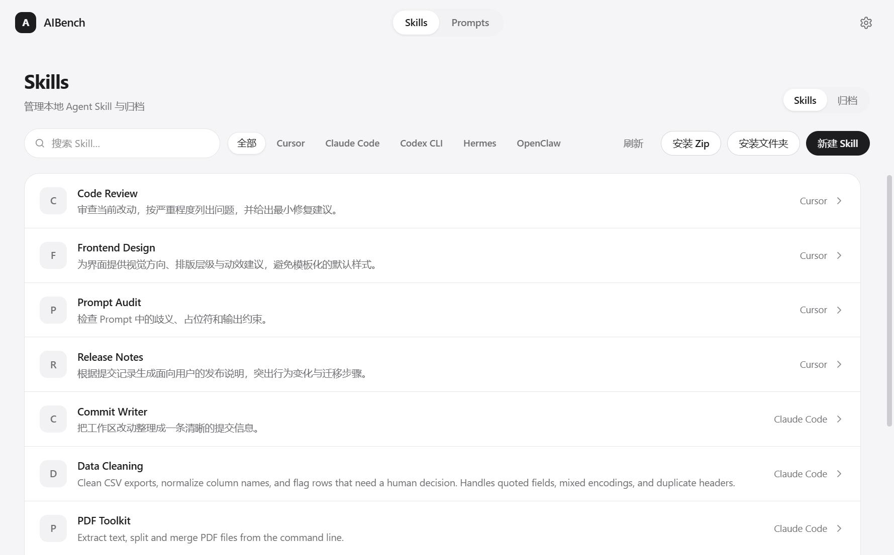
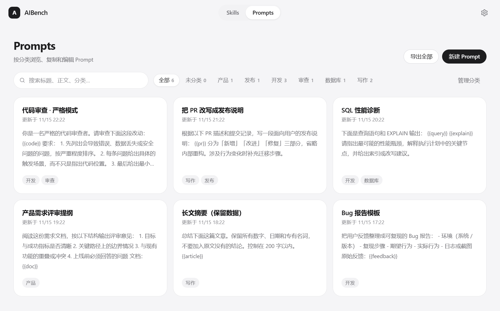
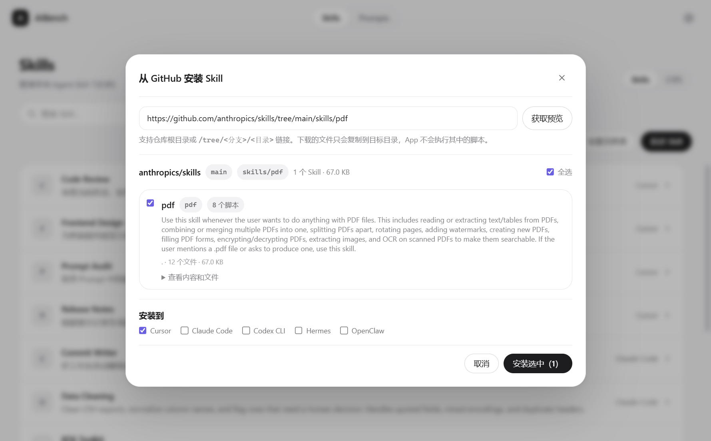
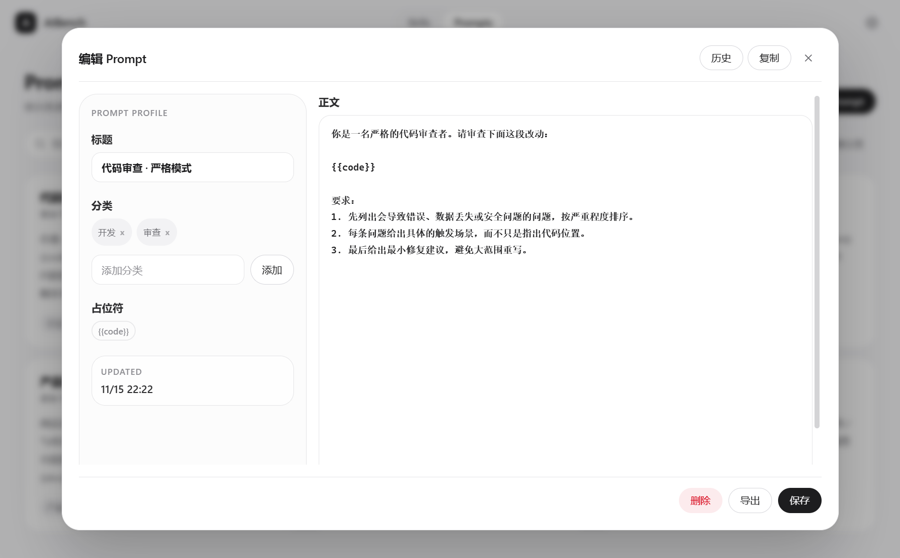
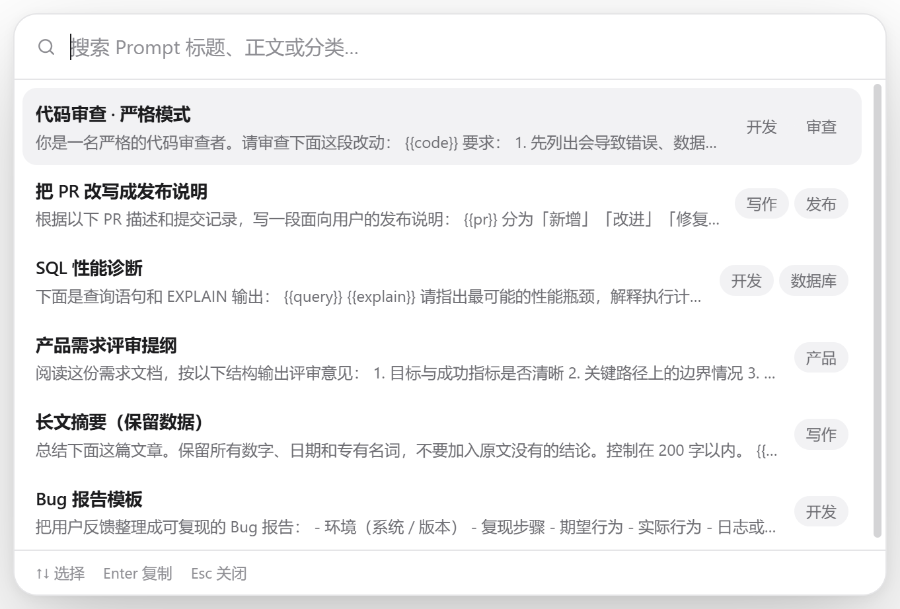

# AIBench

本地 Agent Skill 与 Prompt 管理桌面工具（Electron + React + TypeScript）。

## 界面预览











## 功能

- **Skills**：按 Agent Framework 筛选浏览；安装文件夹 / zip；新建与编辑；归档与恢复；跨 Framework 副本对比与同步
- **GitHub 安装**：粘贴仓库或 `/tree/` 子目录链接，预览 `SKILL.md`、文件列表和脚本后再安装到指定 Framework；不执行下载内容
- **Prompts**：SQLite 存储；卡片浏览；点击卡片打开详情；详情顶部复制正文；分类标签管理；复制时可填充 `{{变量}}`；导出 Markdown；历史版本对比与恢复（每 Prompt 保留 50 条）
- **快速搜索**：托盘常驻，关闭主窗口后继续运行；`Ctrl+Shift+Space`（macOS 为 `Cmd+Shift+Space`）唤起轻量窗口，输入即搜 Prompt，回车复制，含 `{{变量}}` 时可先填写；`Esc` 或失焦收起
- **备份与恢复**：把 Prompt 数据库、设置与归档导出为单个 zip，可附带已安装 Skill；恢复前自动保存当前数据快照
- **健康检查**：只读扫描 Framework 路径、Skill 文件、归档记录和数据库，可一键修复安全问题
- **内置 Framework**：Codex CLI、Cursor、Claude Code、Hermes、OpenClaw；可添加 Custom Framework
- **设置**：Framework 路径、归档目录、导出目录、浅色 / 深色 / 跟随系统主题
- **自动更新**：正式版从 GitHub Releases 后台检查并下载更新，退出时安装

## 技术栈

Electron 35 · React 19 · TypeScript · electron-vite · Tailwind CSS · `node:sqlite`

## 开发

```bash
npm install
npm run dev
npm test          # 单元测试（Node 内置 test runner）
npm run test:e2e  # 端到端冒烟测试：先构建，再用 Playwright 驱动真实 Electron
npm run typecheck
```

e2e 测试通过 `AIBENCH_USER_DATA` 指向临时目录，不会读写真实的 `%APPDATA%/AIBench/` 和已安装 Skill。

### 代码结构

```text
src/main       Electron 主进程：文件系统、SQLite、备份、健康检查、IPC handler
src/preload    通过 contextBridge 暴露 window.aibench
src/renderer   React 界面
src/shared     共享类型、IPC 契约、备份格式
tests          单元测试（Node 内置 test runner）与 tests/e2e（Playwright）
```

约定：

- 所有 IPC 通道的名称、参数和返回类型集中定义在 `src/shared/ipc.ts`。主进程按契约注册 handler（漏注册会编译报错），预载脚本通过类型化 `invoke` 调用，避免两端漂移。
- 数据库 schema 版本记录在 `PRAGMA user_version`，升级逻辑在 `src/main/db-migrations.ts`。新增表或字段时追加迁移，不要修改已经发布的迁移。
- 备份压缩（`backup-worker.ts`，通过 electron-vite 的 `?nodeWorker` 打包）在 worker 线程执行，避免大目录拖慢主进程；主进程只负责导出数据库快照和汇总 manifest。

## 构建

```bash
npm run build
npm run preview
```

## Release

```bash
npm run release          # 本地打包，不上传
npm run release:publish  # 打包并上传到 GitHub Releases（需要 GH_TOKEN）
```

Windows 产物输出到 `release/`，包括安装包、便携版和 zip 包。

自动更新读取 `package.json` 中的 `build.publish`（GitHub Releases）。安装版启动 10 秒后在后台检查，下载完成后弹出系统通知，退出时安装；开发模式、便携版和 `AIBENCH_DISABLE_UPDATES=1` 不检查更新。

代码签名：未配置证书时产物未签名，Windows SmartScreen 会提示。设置 `CSC_LINK`（.pfx 路径）和 `CSC_KEY_PASSWORD` 后 electron-builder 会自动签名安装包与更新包。

数据目录默认：`%APPDATA%/AIBench/`

Codex CLI 默认 Skill 目录：`~/.agents/skills/`

## 后续方向

后续功能与工程改进记录在 [TODO.md](TODO.md)，按投入产出排序，目前包括跨 Framework 同步中心、Skill 体检、Prompt 导入 / Git 同步和使用数据。
