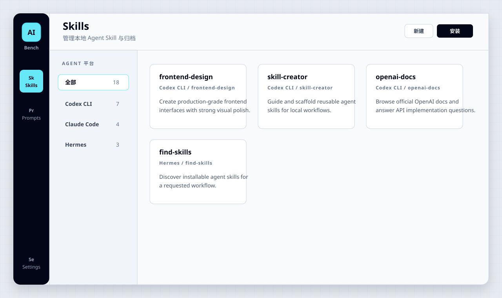
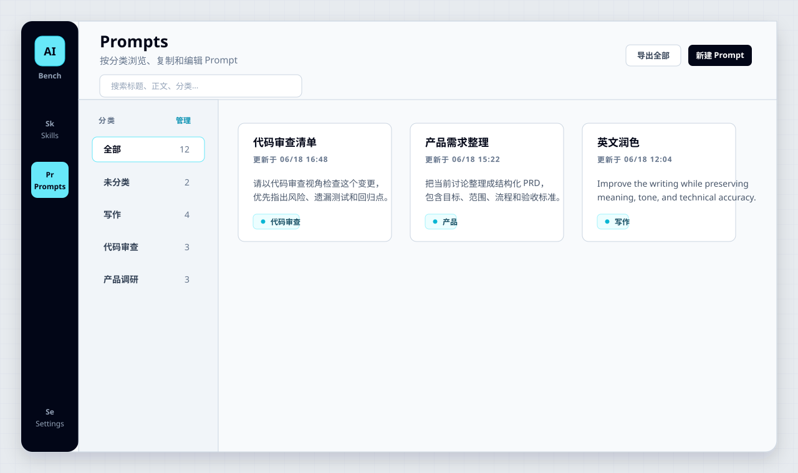
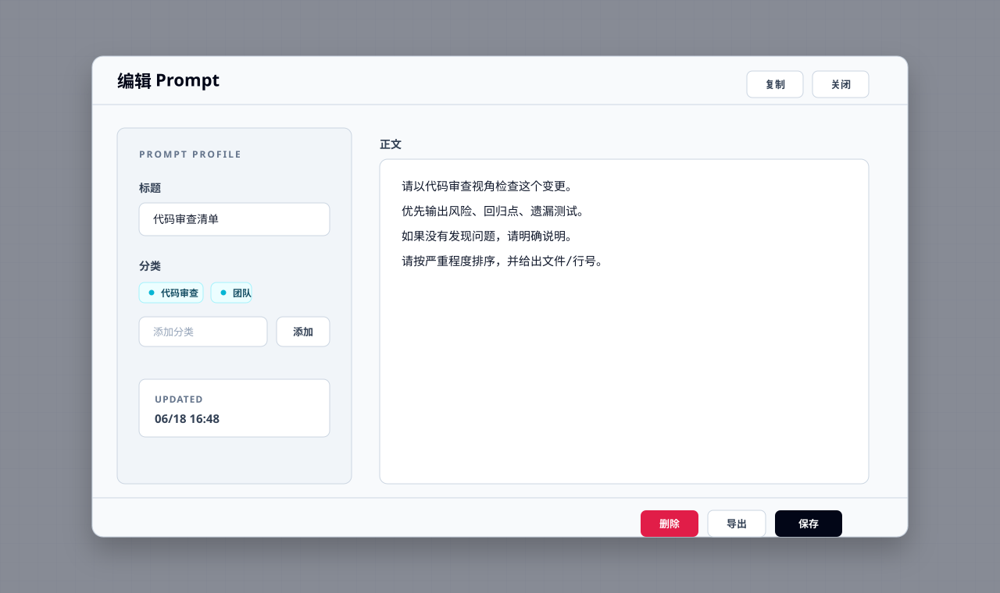

# AIBench

本地 Agent Skill 与 Prompt 管理桌面工具（Electron）。

## 界面预览







## 功能

- **Skills**：按 Agent Framework 分栏浏览；安装文件夹 / zip；新建与编辑；归档与恢复；跨 Framework 副本对比与同步
- **Prompts**：SQLite 存储；卡片浏览；点击卡片打开详情；详情顶部复制正文；分类标签管理；导出 Markdown；历史版本对比与恢复（每 Prompt 保留 50 条）
- **内置 Framework**：Codex CLI、Cursor、Claude Code、Hermes、OpenClaw；可添加 Custom Framework
- **设置**：Framework 路径、归档目录、导出目录、深浅色主题

## 开发

```bash
npm install
npm run dev
npm test        # skill-utils 回归测试（Node 内置 test runner）
npm run typecheck
```

## 构建

```bash
npm run build
npm run preview
```

## Release

```bash
npm run release
```

Windows 产物输出到 `release/`，包括安装包、便携版和 zip 包。

数据目录默认：`%APPDATA%/AIBench/`

Codex CLI 默认 Skill 目录：`~/.agents/skills/`
